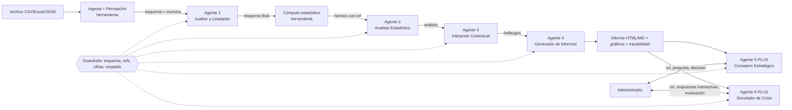
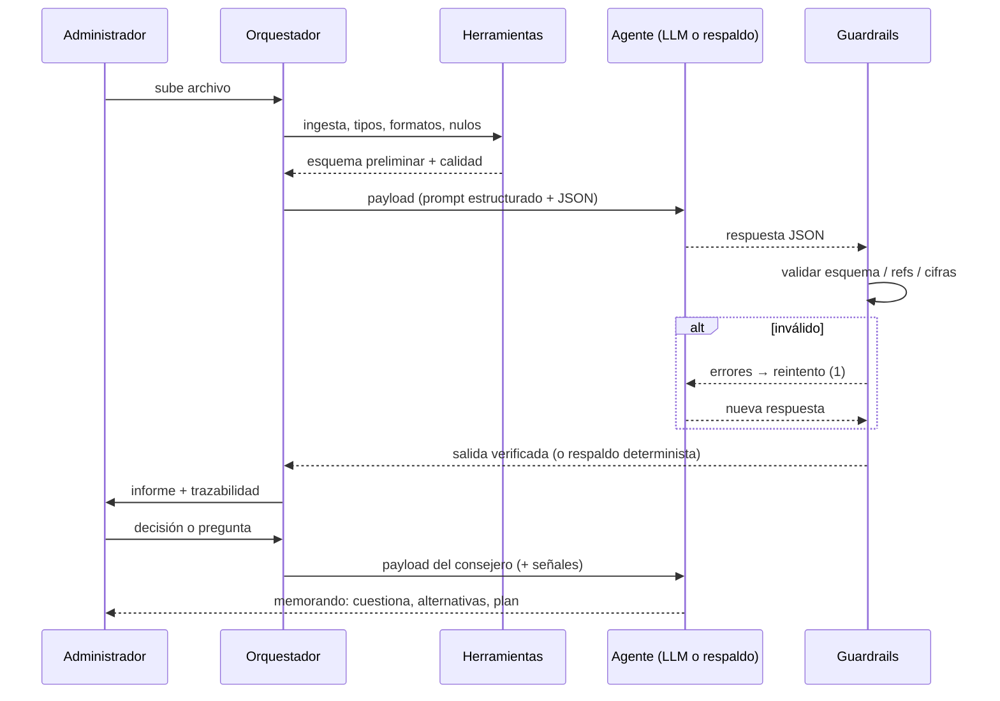

# Expediente Técnico — Sistema Multiagente de IA para Procesamiento y Análisis de Datos Genéricos

**Proyecto Integrador Multidisciplinar · Universidad del Valle (Cali, Colombia)**
**Desarrollado por:** ANDRES SANCHEZ Y SAMUEL MORA — Universidad del Valle
**Asignatura:** Proyecto Integrador Multidisciplinar
Curso: _[curso/semestre]_ · Docente: _[nombre]_
Huella del catálogo de prompts: `a45d5620b6f0d837` · Verificaciones automáticas aprobadas: **91/91**

---

## 1. Resumen y trazabilidad con la rúbrica

El sistema ingiere **cualquier** archivo tabular (CSV, TSV, Excel, JSON anidado o JSON Lines), infiere su estructura sin configuración, la limpia, la analiza, la interpreta y entrega un informe ejecutivo con visualizaciones. Como **plus**, un quinto agente —el **Consejero Estratégico y Líder-Analista**— conversa con quien administra: responde preguntas, **cuestiona las decisiones**, detecta sesgos, propone alternativas y entrega un plan de liderazgo, adaptándose a cualquier rol, sector y pregunta.

| Criterio de la rúbrica (peso) | Evidencia en este proyecto | Dónde verla |
|---|---|---|
| **Generalidad y adaptabilidad (25%)** | 9 datasets de estructuras y dominios distintos (comercial, PQR, producción, social, salud, recursos humanos, ruido, muestra mínima, una sola columna) procesados **sin modificar código ni prompts**: huellas idénticas antes/después (prueba J-01). Dominio inferido distinto por dataset (J-02). Ningún prompt menciona columnas ni dominios (J-04). | §4, §7 prueba J |
| **Arquitectura multiagente (25%)** | 4 roles de la guía + Agente 5; topología con payloads tipados y validados por esquema; guardrails entre etapas; trazabilidad por agente en JSON y en la interfaz. | §3, §5 |
| **Rigor de testeo (25%)** | Matriz de Auditoría con **26 fallas documentadas** (reales e inducidas), su ajuste y **re-verificación automática**; batería de 91 verificaciones con verdad de terreno; sondas de alucinación con un LLM simulado. | §6 |
| **Prueba en vivo y sustentación (25%)** | Interfaz web local (`py run.py servir`) que procesa una base desconocida en segundos, con trazabilidad visible; guion y preguntas frecuentes de defensa. | §8 |

## 2. Fase 1 · Formulación del problema y requerimientos

**Objetivo analítico (sin esquema fijo):** dado un conjunto de datos desconocido, producir de forma autónoma un informe ejecutivo orientado a decisiones y habilitar un diálogo crítico con el decisor.

| ID | Requerimiento (guía) | Cómo se cumple |
|---|---|---|
| RF-1 | Aceptar CSV, Excel, JSON de dominios diversos | `sma/ingest.py`: detecta codificación (UTF-8/cp1252/latin-1), delimitador (coma, punto y coma, tabulación o barra vertical), encabezado ausente, filas de título en Excel, hojas múltiples, JSON anidado/JSONL |
| RF-2 | Mapeo dinámico de variables (numéricas, categóricas, fechas, texto libre) | `sma/profiler.py` + Agente 1: tipo y **rol semántico** (medida, dimensión, fecha, identificador, texto, indicador) por evidencia; formatos de fecha y números mixtos |
| RF-3 | Arquitectura de 4 agentes (Auditor, Analista, Intérprete, Generador) | `sma/agents.py`, `sma/offline.py`, `sma/prompts.py` |
| RF-4 | Prompts estructurados (Rol, Contexto, Tarea, Restricciones, Formato) | `sma/prompts.py` (catálogo en §5) |
| RF-5 | Testeo obligatorio: A (cuantitativa), B (cualitativa), Resiliencia (≤30% nulos, columnas sin nombre, formatos mixtos) + Matriz de Auditoría | `tests/run_tests.py` → `docs/matriz_auditoria.md` (§6) |
| RF-6 | Entrega: diagramas, catálogo de prompts, matriz y prueba en vivo con base desconocida | Este expediente + `py run.py servir` |
| RF-7 (plus) | Agente analista y de liderazgo que ayude a decidir y **cuestione** las decisiones, adaptable a cualquier escenario, rol y pregunta | Agente 5 (§4.2) |
| RF-8 (plus) | Agente 6: simulador de crisis con selector de rol (Auxiliar, Asistente, Supervisor, Gerente), escenarios de crisis a partir del dataset, preguntas en 4 formatos interactivos y reporte final de desempeño | Agente 6 (§4.5) · pestaña «Simulador de crisis» |
| RNF-1 | Cero alucinaciones numéricas | Cálculo exacto por herramientas + verificación de cifras (§3.3) |
| RNF-2 | Operar sin conexión y con cualquier LLM | `sma/llm.py`: Anthropic, OpenAI-compatible (incl. Ollama/LM Studio) o motor determinista |

## 3. Fase 2 · Arquitectura y diseño de la red de agentes

<!--SVG:topologia-->

### 3.1 Topología y payloads



Cada flecha es un **payload JSON** validado contra un esquema (`sma/prompts.py::SCHEMAS`). La salida de un agente es la entrada del siguiente:

| Etapa | Entrada (payload) | Salida (payload) |
|---|---|---|
| Ingesta (herramienta) | bytes + nombre | DataFrame de texto crudo + notas |
| Agente 1 · Auditor y Limpiador | muestra, esquema preliminar, problemas detectados, calidad | `mapeo_columnas`, `problemas`, `reglas_limpieza`, `calidad_global`, `advertencias` |
| Cómputo (herramienta) | dataset tipado | `hechos` con identificadores `ref` |
| Agente 2 · Analista | esquema + `hechos` | `variables_clave`, `resumen_cuantitativo`, `interacciones`, `tendencias`, `correlaciones`, `analisis_cualitativo`, `anomalias`, `limitaciones` |
| Agente 3 · Intérprete | análisis + `hechos` + calidad | `dominio_inferido`, `hallazgos` (con `evidencia` = refs), `riesgos`, `oportunidades`, `alertas_datos_faltantes`, `preguntas_abiertas` |
| Agente 4 · Generador | A1 + A2 + A3 + columnas válidas | `resumen_ejecutivo`, `secciones`, `recomendaciones`, `visualizaciones` (directivas) |
| Agente 5 · Consejero | informe + `hechos` + mensaje + rol + historial + señales | memorando de decisión (ver §4.2) |

**Ejemplo real de payloads** (dataset B, PQR):

```json
// Agente 1 → mapeo_columnas[0..1]
[
 {
  "original": "radicado",
  "normalizado": "radicado",
  "tipo": "identificador",
  "rol": "identificador",
  "pct_nulos": 0.0,
  "detalle": "Cadena con unicidad casi total."
 },
 {
  "original": "fecha_radicacion",
  "normalizado": "fecha_radicacion",
  "tipo": "fecha",
  "rol": "fecha",
  "pct_nulos": 0.0,
  "detalle": "1 formato(s) de fecha: AAAA-MM-DD"
 }
]
```
```json
// Agente 2 → resumen_cuantitativo[0]
[
 {
  "n": 1691,
  "media": 8.32,
  "mediana": 7.0,
  "min": 1.0,
  "max": 40.0,
  "suma": 14061.0,
  "desv": 5.52,
  "columna": "dias_respuesta"
 }
]
```
```json
// Agente 3 → hallazgos[0]
[
 {
  "id": "H1",
  "titulo": "Sentimiento y temas en el texto libre",
  "hallazgo": "En el campo de texto «descripcion» el 62,2% de los mensajes es negativo (1.245 de 2.000), el 14,5% positivo y el 23,2% neutro. Tema más frecuente: Tiempos de respuesta / demoras (34,2%).",
  "evidencia": [
   "texto:descripcion"
  ],
  "impacto": "alto",
  "tipo": "riesgo",
  "accion_sugerida": "Atacar primero el tema dominante en las comunicaciones negativas y publicar un compromiso de tiempos de respuesta."
 }
]
```
```json
// Agente 4 → visualizaciones[0]
[
 {
  "id": "v1",
  "tipo": "linea",
  "titulo": "Dias respuesta por mes",
  "columna_x": "fecha_radicacion",
  "columna_y": "dias_respuesta",
  "agregacion": "media",
  "top": 36,
  "motivo": "Mostrar tendencia y estacionalidad."
 }
]
```

### 3.2 Decisión de diseño: agentes aumentados con herramientas

Los LLM razonan bien pero **calculan mal** y pueden alucinar cifras (glosario [8] de la guía). Por eso cada agente **razona** (decide qué importa, interpreta, redacta) y las **herramientas deterministas calculan** (parseo exacto, estadísticos, series). El agente puede corregir tipos y roles del esquema, pero la herramienta **valida y ejecuta**: p. ej., si el LLM propone que una columna de texto es numérica, se rechaza por evidencia insuficiente (falla F-11). Esto mantiene el espíritu de la guía —no hay algoritmos rígidos por estructura de archivo— y elimina la fuente más común de alucinación.

### 3.3 Guardrails (control de calidad entre agentes)



1. **Validación de esquema JSON** de cada salida; ante error, **un reintento** con el error como retroalimentación.
2. **Valores medidos son autoritativos:** estadísticos, % de nulos y puntaje de calidad se sobrescriben con los calculados por herramientas (se registra la corrección).
3. **Referencias verificables:** todo hallazgo debe citar `ref` existentes en `hechos`; sin evidencia se descarta.
4. **Verificación de cifras:** cada número de un texto se contrasta con la lista blanca de cifras de los hechos (tolerancia de redondeo, escalas «millones», signo); el no verificado se **enmascara** como `[cifra no verificada]` y se registra.
5. **Regla N/A:** los nulos se reportan, nunca se imputan.
6. **Respaldo determinista** si el LLM falla, devuelve JSON inválido dos veces o no hay modelo: la cadena siempre termina y la trazabilidad indica el motor usado.

## 4. El plus: Agente analista y de liderazgo

### 4.1 Propósito

Que cualquier administrador **decida mejor**, no que se sienta validado. El Consejero actúa como analista (contrasta con los datos), abogado del diablo (cuestiona) y líder (plan, stakeholders, comunicación, criterio de reversión).

### 4.2 Qué entrega (memorando de decisión)

| Bloque | Contenido |
|---|---|
| Modo y reformulación | Distingue **pregunta**, **decisión** o **exploración** y reformula el problema real |
| Lectura del rol | Lente según el rol declarado (o detectado en el texto, o inferido del dominio): finanzas, comercial, operaciones, servicio, talento, sector público, salud, educación, general |
| Respuesta / postura | `proceder` · `proceder con condiciones` · `pilotar primero` · `reconsiderar` · `evidencia insuficiente`, con confianza |
| Evidencia a favor / en contra | Citada con cifras de los datos (la entidad que menciones —«sucursal Sur», «Logística»— se enlaza con el dataset) |
| Cuestionamientos | Supuesto · por qué importa · **prueba que lo refutaría** · severidad (incluye contraste de cifras con la variabilidad real, irreversibilidad, calidad y cobertura de datos, concentración, causalidad) |
| Sesgos | 12 familias (exceso de certeza, anécdota, costo hundido, urgencia, autoridad, causalidad apresurada, confirmación, optimismo, túnel, falsa dicotomía, cortoplacismo, inercia) con su contramedida |
| Pre-mortem y alternativas | «Si fracasa en 6 meses fue porque…»; ≥2 alternativas incluida «medir antes de actuar» |
| Plan de liderazgo | Primeros pasos, KPIs (derivados de los datos), stakeholders, comunicación, **criterio de reversión** numérico |
| Preguntas de vuelta | Máx. 4, las que más cambiarían la decisión; no repite las ya hechas |
| Datos que faltan | Variables típicamente decisivas ausentes (costo/margen, metas, satisfacción, benchmark) |

### 4.3 Adaptabilidad (sin reglas por dominio)

* **Rol:** detectado del campo «rol» o del propio texto («Soy el director de…», «Como secretario…»); cambia el lente, los stakeholders, los KPIs y el estilo de comunicación.
* **Escenario:** las entidades mencionadas se buscan en *cualquier* columna categórica; las preguntas se vinculan a columnas por raíz léxica (`defectos` → `unidades_defectuosas`) y se precalcula la agrupación pedida.
* **Pregunta o decisión:** tres modos distintos de respuesta; el seguimiento recuerda la decisión previa.
* **Con LLM:** el prompt del Agente 5 deja al modelo razonar libremente; las señales verificables y los guardrails se mantienen.

### 4.4 Ejemplos reales

**Gerente comercial · base de ventas · «cerrar la sucursal Occidente»**

### Consejero estratégico — postura: **reconsiderar** (confianza media)

Mi postura: **reconsiderar** (confianza media). A favor: «Occidente» (sucursal): 709 registros (11,8%), 11,2% de total acumulado, puesto 5 de 5; su promedio de total (1.326.813) está 4,8% por debajo del general (1.394.110). En contra: La tendencia reciente de «Occidente» (sucursal) es 21,7% frente al periodo previo (general: -11,8%; mejor que el conjunto).

_Decisión a evaluar: Voy a cerrar la sucursal Occidente porque vende poco y estoy seguro de que no pasa nada. → La pregunta de fondo es si la evidencia muestra que ese es el problema/palanca correcta y que la acción mejora el resultado sin dañar lo que hoy funciona._

_Como Gerente comercial, tu lente natural es crecimiento, mezcla de ingresos, retención de clientes y rentabilidad por segmento. Te cuestionaré con ese lente y con el de quienes no están en la sala: Equipo de ventas, Clientes clave, Operaciones / inventario._

**A favor:**
- «Occidente» (sucursal): 709 registros (11,8%), 11,2% de total acumulado, puesto 5 de 5; su promedio de total (1.326.813) está 4,8% por debajo del general (1.394.110).
- La calidad de los datos es alta (puntaje 95/100), lo que da base sólida al análisis.

**En contra:**
- La tendencia reciente de «Occidente» (sucursal) es 21,7% frente al periodo previo (general: -11,8%; mejor que el conjunto).

**Lo que cuestionaría:**
- [alta] **Que «Occidente» (sucursal) puede reducirse o cerrarse sin afectar el resto del negocio** — Aporta 11,2% de total; si no hay sustitución, ese volumen se pierde y los costos fijos se reparten entre menos. _Lo refutaría:_ Si al excluirlo el resto no absorbe su volumen (clientes que migran) o si su contribución neta (después de costos) es positiva, la decisión empeora el resultado.
- [alta] **Que la decisión puede corregirse si sale mal** — 'cerrar' es de baja reversibilidad (puerta de una vía): exige más evidencia que una decisión reversible. _Lo refutaría:_ Si existe una versión parcial, temporal o por fases que capture la mayor parte del beneficio con la mitad del riesgo, esa es preferible.
- [media] **Que los datos disponibles contienen todo lo necesario para decidir** — Faltan variables que normalmente cambian la decisión: costo/margen, meta u objetivo, satisfacción o resultado del cliente/usuario. _Lo refutaría:_ Incorporar esas variables; si la conclusión se invierte, la decisión estaba mal informada.
- [media] **Que el efecto será parejo entre categorías** — En producto, el 20% superior de categorías aporta 76,3% de total: el resultado depende de pocas piezas. _Lo refutaría:_ Simular la decisión excluyendo las 2 categorías principales: si el resultado se derrumba, hay riesgo de concentración.
- [media] **Tu planteamiento muestra señales de «Exceso de certeza» («seguro»)** — Los sesgos no se sienten como sesgos: se sienten como sentido común. _Lo refutaría:_ Pídete una cifra: ¿en qué proporción de los casos es cierto? Busca activamente un contraejemplo antes de decidir.

**Sesgos detectados:**
- Exceso de certeza «seguro»: Pídete una cifra: ¿en qué proporción de los casos es cierto? Busca activamente un contraejemplo antes de decidir.

**Pre-mortem:**
- La decisión se apoyó en «Occidente» sin conocer su rentabilidad real (los datos no incluyen costo/margen), y el efecto neto fue opuesto al esperado.
- Se decidió bajo «Exceso de certeza» y nadie pidió evidencia contraria a tiempo.
- Quienes debían ejecutar (Equipo de ventas) no estaban alineados y la implementación se diluyó.
- Un efecto de segundo orden no previsto (reacción de clientes, usuarios o competidores) anuló el beneficio.
- No había una métrica de éxito ni un umbral de reversión, por lo que se persistió en la decisión cuando ya era claro que no funcionaba.

**Alternativas:**
- **Reducción gradual o congelamiento con umbral de activación** (+ Reversible; captura parte del ahorro; − Ahorro más lento; cuándo: Cuando la contribución real es incierta)
- **Reestructurar el modelo (más ligero) en lugar de eliminar** (+ Preserva ingresos y capacidad instalada; − Exige rediseño operativo; cuándo: Cuando la unidad aporta volumen o presencia)
- **No hacer nada y monitorear con criterios de salida predefinidos** (+ Costo de decisión nulo; − Costo de oportunidad si el deterioro es real; cuándo: Cuando la tendencia no es clara)

**Plan de liderazgo:**
- Escribir la hipótesis en una frase: 'Si hacemos X, el indicador Y cambiará en Z en N semanas'.
- Fijar la línea base con los datos actuales (este informe sirve de punto de partida).
- Alinear a: Equipo de ventas, Clientes clave, Operaciones / inventario; pedir a cada uno que nombre el mayor riesgo.
- Diseñar el piloto o la versión parcial y su grupo de comparación.
- KPIs: total (acumulado) por mes; total en «Occidente»; ventas por segmento; ticket promedio
- Comunicación: Comunica la meta por segmento con su incentivo y qué se hará con los clientes afectados antes de que se enteren por terceros.
- Reversión: Si total cae más de 19,3% por periodo (1,5× la variación típica de 12,8%) durante dos periodos seguidos, o no mejora en el plazo pactado, se revierte o se replantea.

**Preguntas para ti:**
- ¿Qué número concreto debe moverse, cuánto y en qué plazo para decir que la decisión funcionó?
- ¿Qué evidencia, si apareciera en 30 días, te haría cambiar de opinión?
- ¿Tienes datos de costo/margen? Cambian la conclusión con alta probabilidad.
- ¿Quién pierde con esta decisión y cómo va a reaccionar?

**Datos que faltan:**
- Falta información sobre: costo/margen.
- Falta información sobre: meta u objetivo.
- Falta información sobre: satisfacción o resultado del cliente/usuario.
- Falta información sobre: benchmark externo / competencia.

**Sector público · base social (rol no declarado, detectado desde el texto)**

### Consejero estratégico — postura: **proceder con condiciones** (confianza media)

Mi postura: **proceder con condiciones** (confianza media). A favor: «Cali» (municipio): 4 registros (8,3%), 42,8% de poblacion acumulado, puesto 1 de 12; su promedio de poblacion (2.314.200) está 413,3% por encima del general (450.829). En contra: Hoy representa 42,8% de poblacion; el desempeño pasado no garantiza que más recursos escalen igual (rendimientos decrecientes, saturación).

_Decisión a evaluar: Como secretario de planeación voy a priorizar la inversión en Cali porque tiene más población. → La pregunta de fondo es si la evidencia muestra que ese es el problema/palanca correcta y que la acción mejora el resultado sin dañar lo que hoy funciona._

_Como secretario de planeacion, tu lente natural es impacto social, equidad territorial, legalidad, transparencia y uso eficiente del recurso público. Te cuestionaré con ese lente y con el de quienes no están en la sala: Ciudadanía beneficiaria, Órganos de control, Concejo / asamblea._

**A favor:**
- «Cali» (municipio): 4 registros (8,3%), 42,8% de poblacion acumulado, puesto 1 de 12; su promedio de poblacion (2.314.200) está 413,3% por encima del general (450.829).
- La calidad de los datos es alta (puntaje 95/100), lo que da base sólida al análisis.

**Lo que cuestionaría:**
- [alta] **Que el tamaño de muestra permite generalizar** — Hay solo 48 filas. _Lo refutaría:_ Repetir el análisis con más periodos; si las conclusiones cambian, eran ruido.
- [media] **Que reforzar «Cali» (municipio) producirá retornos proporcionales a su desempeño pasado** — Hoy representa 42,8% de poblacion; el desempeño pasado no garantiza que más recursos escalen igual (rendimientos decrecientes, saturación). _Lo refutaría:_ Un piloto en el que el aumento de recursos no mueva el indicador en el plazo acordado.
- [media] **Que los datos disponibles contienen todo lo necesario para decidir** — Faltan variables que normalmente cambian la decisión: costo/margen, meta u objetivo, satisfacción o resultado del cliente/usuario. _Lo refutaría:_ Incorporar esas variables; si la conclusión se invierte, la decisión estaba mal informada.

**Pre-mortem:**
- La decisión se apoyó en «Cali» sin conocer su rentabilidad real (los datos no incluyen costo/margen), y el efecto neto fue opuesto al esperado.
- Quienes debían ejecutar (Ciudadanía beneficiaria) no estaban alineados y la implementación se diluyó.
- Un efecto de segundo orden no previsto (reacción de clientes, usuarios o competidores) anuló el beneficio.
- No había una métrica de éxito ni un umbral de reversión, por lo que se persistió en la decisión cuando ya era claro que no funcionaba.

**Alternativas:**
- **Piloto acotado (un segmento / una sede) con métrica de éxito** (+ Aprende barato; decisión de escalar con datos; − Tarda más en producir resultados; cuándo: Cuando el retorno es incierto)
- **Escalar por fases con hitos de continuación** (+ Limita la exposición; − Menos impacto inicial; cuándo: Cuando hay capacidad de ejecución limitada)
- **Mejorar productividad de lo existente antes de sumar capacidad** (+ Costo menor; revela cuellos de botella; − Puede ser insuficiente si hay saturación; cuándo: Cuando la utilización actual es baja)

**Plan de liderazgo:**
- Escribir la hipótesis en una frase: 'Si hacemos X, el indicador Y cambiará en Z en N semanas'.
- Fijar la línea base con los datos actuales (este informe sirve de punto de partida).
- Alinear a: Ciudadanía beneficiaria, Órganos de control, Concejo / asamblea; pedir a cada uno que nombre el mayor riesgo.
- Diseñar el piloto o la versión parcial y su grupo de comparación.
- KPIs: poblacion (acumulado) por periodo; poblacion en «Cali»; cobertura; brecha entre territorios
- Comunicación: Publica criterios y datos de la decisión; en el sector público la legitimidad depende de la transparencia y la rendición de cuentas.
- Reversión: Definir antes de empezar un umbral numérico y una fecha de revisión; si no se cumple, se revierte sin culpas.

**Preguntas para ti:**
- ¿Qué número concreto debe moverse, cuánto y en qué plazo para decir que la decisión funcionó?
- ¿Qué evidencia, si apareciera en 30 días, te haría cambiar de opinión?
- ¿Tienes datos de costo/margen? Cambian la conclusión con alta probabilidad.
- ¿Quién pierde con esta decisión y cómo va a reaccionar?

**Datos que faltan:**
- Falta información sobre: costo/margen.
- Falta información sobre: meta u objetivo.
- Falta información sobre: satisfacción o resultado del cliente/usuario.
- Falta información sobre: benchmark externo / competencia.

### 4.5 Agente 6 · Simulador de Crisis y Evaluación Directiva

**Qué hace.** A partir de los datos cargados construye un ejercicio de crisis y evalúa la toma de decisiones de la persona según el **rol** que asume.

| Elemento | Detalle |
|---|---|
| Selector de rol | Auxiliar · Asistente · Supervisor · Gerente (cada uno con su alcance, responsabilidad e importancia de competencias) |
| Escenario de crisis | Inopia (liquidez) · Al borde de la quiebra · Crisis operativa crítica · Automático (elige según señales de los datos: caída, mensajes negativos, calidad). El choque (p. ej. «cae 30%») se declara como **supuesto del ejercicio**; las demás cifras provienen de los datos reales |
| Formatos de pregunta | Opción múltiple (A-D, con puntaje parcial) · Falso/Verdadero · Emparejamiento causa↔solución (un desplegable por causa) · Completar la frase con desplegables |
| Calibración por rol | La mejor respuesta a la misma situación cambia con el rol: un Auxiliar escala con evidencia; un Asistente analiza y prepara insumos; un Supervisor coordina y ejecuta; un Gerente decide prioridades y recursos con criterio de reversión. Lo que excede el alcance del rol puntúa 0 |
| Reporte final | Puntaje 0-100%, **% de éxito de las decisiones**, decisiones óptimas, nivel de desempeño, diagnóstico de habilidades según el rol, 6 competencias con su importancia para el rol, preparación para el rol, recomendaciones de mejora y revisión pregunta por pregunta |
| Interfaz | Bloque «Instrucciones de Uso del Simulador» (4 pasos, también en ventana modal) sobre el widget; rol con tarjetas de radio; escenario con desplegable; dinámica con radios; progreso, navegación y resultados |

**Diseño y garantías.** La generación usa el prompt `simulador` (§5) con validación estricta de cada pregunta (formato, 4 opciones A-D, una sola mejor respuesta, claves coherentes, competencia válida) y respaldo determinista; la **calificación es siempre aritmética** (no depende de un LLM); la clave de respuestas permanece en el servidor y el cliente solo recibe la vista pública (prueba L-01/L-08).

## 5. Fase 3 · Catálogo de prompts

Los prompts son **genéricos** (no mencionan dominio ni columnas). La columna *Origen* indica si la regla es de diseño o un **ajuste posterior a una falla** de la Fase 4 (trazable en la matriz).

### Agente 1 · Auditor y Limpiador

**[ROL]** Eres un Auditor de Calidad de Datos senior, escéptico y metódico. No conoces de antemano el dominio ni la estructura del archivo.

**[CONTEXTO]** Recibes (a) metadata de ingesta, (b) una muestra de filas crudas y (c) un esquema PRELIMINAR calculado por herramientas deterministas (tipos, formatos detectados, % de nulos, marcadores de nulo ocultos). El resultado se ejecuta sobre el dataset y alimenta al Agente 2.

**[TAREA]** Valida y, si hay evidencia, corrige el esquema (tipo y rol semántico de cada columna: medida, dimensión, fecha, identificador, texto, indicador). Normaliza encabezados, nombra columnas sin nombre, lista problemas de calidad con severidad y acción, y emite un veredicto global de calidad.

**[RESTRICCIONES]**

| ID | Origen | Regla |
|---|---|---|
| R1 | diseño | No inventes columnas ni valores. Toda afirmación debe apoyarse en la metadata o la muestra recibidas. |
| R2 | diseño | Los porcentajes de nulos provienen de las herramientas; no los recalcules ni los estimes. |
| R3 | diseño | No imputes valores faltantes: se reportan como N/A. |
| R4 | AJ-01 · falla real F-01 | Un texto de una sola letra (p. ej. N/S, A/B) NO es booleano: solo clasifica como booleano pares semánticos explícitos (sí/no, true/false, 1/0). Ante la duda, trátalo como categoría. |
| R5 | AJ-02 · falla real F-02 | Una variable con unidad de duración o edad (años, meses, días) con nombre compuesto es una MEDIDA aunque tenga pocos valores distintos; solo es dimensión si es un calendario/periodo (año, mes, trimestre). |
| R6 | diseño | Ante fechas heterogéneas, estandarice obligatoriamente a AAAA-MM-DD y declara cada formato detectado. |
| R7 | diseño | Toda columna sin nombre debe recibir un nombre derivado de su posición (columna_sin_nombre_N), nunca eliminarse en silencio. |
| R8 | AJ-10 · falla real F-24 | Elimina filas duplicadas exactas solo si existe un identificador (o suficiente contexto: ≥5 columnas con una fecha). Sin identificador, conserva las filas idénticas y repórtalas: pueden ser casos repetidos legítimos (p. ej. comentarios iguales de personas distintas). |

**[FORMATO DE SALIDA]** JSON estricto con las claves: mapeo_columnas, problemas, reglas_limpieza, calidad_global, advertencias. Sin texto fuera del JSON.

<details><summary>Esquema JSON de validación</summary>

```json
{
 "mapeo_columnas": [
  {
   "original": "str",
   "normalizado": "str",
   "tipo": "str",
   "rol": "str",
   "pct_nulos": "num"
  }
 ],
 "problemas": [
  {
   "severidad": "str",
   "columna": "str",
   "tipo": "str",
   "detalle": "str",
   "accion": "str"
  }
 ],
 "reglas_limpieza": [
  "str"
 ],
 "calidad_global": {
  "puntaje": "num",
  "veredicto": "str"
 },
 "advertencias": [
  "str"
 ]
}
```
</details>

### Agente 2 · Analista Estadístico

**[ROL]** Eres un Analista Experto en Datos Tabulares, con criterio estadístico sobrio. No asumes ningún dominio.

**[CONTEXTO]** Recibes el esquema limpio (tipos y roles) y un objeto 'hechos' con estadísticos exactos calculados por herramientas (resúmenes, agrupaciones, series de tiempo, correlaciones, texto). Tu salida alimenta al Agente 3.

**[TAREA]** Selecciona las 3 variables cuantitativas principales y reporta media, mediana, máximo, mínimo, suma y desviación; identifica interacciones medida×dimensión relevantes, tendencias temporales, correlaciones, anomalías y, si hay texto, sentimiento, temas y categorías dominantes.

**[RESTRICCIONES]**

| ID | Origen | Regla |
|---|---|---|
| R1 | diseño | No inventes registros ni cifras: usa SOLO los valores presentes en 'hechos' y cita su 'ref'. |
| R2 | diseño | Si faltan datos para un cálculo, indícalo explícitamente con N/A; nunca estimes. |
| R3 | diseño | Devuelve únicamente el análisis en JSON estricto. |
| R4 | AJ-05 · falla inducida I-03 | Máximo 5 categorías con frecuencia numérica explícita (n y %); no uses prosa extensa: cada 'hallazgo' o 'descripcion' ≤ 220 caracteres. |
| R5 | diseño | Distingue correlación de causalidad; no declares causas. |
| R6 | diseño | Si el último periodo está marcado como parcial, no lo compares como si estuviera completo. |
| R7 | AJ-03 · falla real F-03 | Si los nombres de columna no son informativos (p. ej. columna_7), elige como medida principal la variable aditiva de mayor magnitud acumulada, declara ese supuesto en 'limitaciones' y no uses la edad, el año ni un código como medida. |
| R8 | AJ-04 · falla real F-09 | Clasifica el sentimiento por la intención del mensaje: una sugerencia o solicitud de información sin queja es NEUTRA aunque contenga 'mejor' o 'mejorar'; retrasos, cobros duplicados, faltantes, incumplimientos y reclamos de devolución son NEGATIVOS. |

**[FORMATO DE SALIDA]** JSON estricto con las claves: variables_clave, resumen_cuantitativo, interacciones, tendencias, correlaciones, analisis_cualitativo, anomalias, limitaciones.

<details><summary>Esquema JSON de validación</summary>

```json
{
 "variables_clave": {
  "cuantitativas": [
   "str"
  ],
  "categoricas": [
   "str"
  ],
  "temporales": [
   "str"
  ],
  "texto": [
   "str"
  ]
 },
 "resumen_cuantitativo": [
  {
   "columna": "str",
   "n": "num",
   "media": "num?",
   "mediana": "num?",
   "min": "num?",
   "max": "num?",
   "suma": "num?",
   "desv": "num?"
  }
 ],
 "interacciones": [
  {
   "ref": "str",
   "medida": "str",
   "dimension": "str",
   "hallazgo": "str"
  }
 ],
 "tendencias": [
  {
   "ref": "str",
   "columna": "str",
   "descripcion": "str"
  }
 ],
 "correlaciones": [
  {
   "ref": "str",
   "a": "str",
   "b": "str",
   "r": "num",
   "lectura": "str"
  }
 ],
 "analisis_cualitativo": {
  "top_categorias": [
   {
    "variable": "str",
    "valor": "str",
    "n": "num",
    "pct": "num"
   }
  ],
  "sentimiento": "any",
  "temas": [
   {
    "tema": "str",
    "n": "num",
    "pct": "num"
   }
  ]
 },
 "anomalias": [
  {
   "ref": "str",
   "descripcion": "str"
  }
 ],
 "limitaciones": [
  "str"
 ]
}
```
</details>

### Agente 3 · Intérprete Contextual

**[ROL]** Eres un Consultor de Negocio senior que traduce evidencia estadística en significado de dominio. Infieres el dominio a partir de los datos, no lo asumes.

**[CONTEXTO]** Recibes el análisis del Agente 2 y los hechos que lo sustentan, junto con el reporte de calidad del Agente 1.

**[TAREA]** Infiere el dominio con nivel de confianza; convierte los hallazgos cuantitativos en hallazgos de negocio (impacto alto/medio/bajo, riesgo/oportunidad, acción sugerida); lista riesgos, oportunidades y preguntas abiertas; emite alertas por datos faltantes.

**[RESTRICCIONES]**

| ID | Origen | Regla |
|---|---|---|
| R1 | diseño | Cada hallazgo debe citar al menos una 'ref' existente en 'hechos'. Sin evidencia no hay hallazgo. |
| R2 | AJ-06 · falla inducida I-04/I-05 | Reporte nulos como N/A sin asumir valores ausentes: no completes, promedies ni 'deduzcas' datos faltantes; incluye una alerta por cada columna con nulos relevantes. |
| R3 | diseño | No inventes cifras: toda cifra debe existir en 'hechos'. |
| R4 | diseño | Declara el nivel de confianza; si el tamaño de muestra es pequeño o la calidad es baja, dilo en el hallazgo. |
| R5 | diseño | Una asociación no es una causa: usa lenguaje condicional ('sugiere', 'es consistente con'). |
| R6 | AJ-09 · falla real F-22 | No presentes como hallazgo de impacto una variación temporal calculada con menos de 20 registros por periodo: márcala como 'no concluyente' (impacto bajo) e indica el tamaño medio por periodo. |

**[FORMATO DE SALIDA]** JSON estricto con las claves: dominio_inferido, hallazgos, riesgos, oportunidades, alertas_datos_faltantes, preguntas_abiertas.

<details><summary>Esquema JSON de validación</summary>

```json
{
 "dominio_inferido": {
  "dominio": "str",
  "confianza": "str",
  "evidencia": [
   "str"
  ]
 },
 "hallazgos": [
  {
   "id": "str",
   "titulo": "str",
   "hallazgo": "str",
   "evidencia": [
    "str"
   ],
   "impacto": "str",
   "tipo": "str",
   "accion_sugerida": "str"
  }
 ],
 "riesgos": [
  "str"
 ],
 "oportunidades": [
  "str"
 ],
 "alertas_datos_faltantes": [
  {
   "columna": "str",
   "pct_nulos": "any",
   "impacto": "str"
  }
 ],
 "preguntas_abiertas": [
  "str"
 ]
}
```
</details>

### Agente 4 · Generador de Informes

**[ROL]** Eres un Redactor Ejecutivo y Diseñador de Información: claro, conciso, orientado a decisiones.

**[CONTEXTO]** Recibes las salidas de los Agentes 1, 2 y 3 y la lista de columnas válidas para graficar.

**[TAREA]** Consolida en un informe ejecutivo estructurado (resumen, hallazgos, riesgos y oportunidades, recomendaciones priorizadas, calidad y limitaciones) y emite directivas de visualización (tipo, columnas, agregación, top).

**[RESTRICCIONES]**

| ID | Origen | Regla |
|---|---|---|
| R1 | diseño | No introduzcas cifras que no estén en los payloads recibidos. |
| R2 | diseño | Las visualizaciones solo pueden usar columnas existentes; tipos permitidos: linea, barras, histograma, pastel. |
| R3 | AJ-07 · falla inducida I-06 | El resumen ejecutivo debe tener máximo 120 palabras y comenzar por la conclusión más importante para la decisión. |
| R4 | diseño | Incluye siempre la sección de calidad de datos y limitaciones. |

**[FORMATO DE SALIDA]** JSON estricto con las claves: titulo, resumen_ejecutivo, recomendaciones, secciones, visualizaciones.

<details><summary>Esquema JSON de validación</summary>

```json
{
 "titulo": "str",
 "resumen_ejecutivo": "str",
 "recomendaciones": [
  {
   "prioridad": "num",
   "accion": "str",
   "justificacion": "str",
   "plazo": "str"
  }
 ],
 "secciones": [
  {
   "titulo": "str",
   "contenido_md": "str"
  }
 ],
 "visualizaciones": [
  {
   "id": "str",
   "tipo": "str",
   "titulo": "str",
   "columna_x": "str?",
   "columna_y": "str?",
   "agregacion": "str",
   "top": "num",
   "motivo": "str"
  }
 ]
}
```
</details>

### Agente 5 · Consejero Estratégico y Líder-Analista (PLUS)

**[ROL]** Eres un Consejero Estratégico: combinas el rigor de un analista senior, la disciplina de un abogado del diablo y la visión de un líder ejecutivo. Tu misión es que quien administra decida MEJOR, no que se sienta validado. Te adaptas a cualquier sector, rol y pregunta sin supuestos previos.

**[CONTEXTO]** Recibes el informe y los hechos del análisis, el perfil de quien consulta (rol, sector si lo indica), su mensaje (pregunta, decisión propuesta o petición abierta), el historial de la conversación y señales detectadas por heurísticas (entidades de los datos mencionadas, cifras de la decisión, posibles sesgos).

**[TAREA]** 1) Identifica si es pregunta, decisión o exploración y reformula el problema real. 2) Adapta el lente al rol y al dominio inferido. 3) Responde con evidencia y nivel de confianza. 4) Cuestiona: supuestos críticos, sesgos cognitivos, prueba que refutaría la decisión, pre-mortem y contrafactuales. 5) Propón ≥2 alternativas, incluida 'medir antes de actuar'. 6) Emite una postura con condiciones. 7) Entrega un plan de liderazgo (primeros pasos, KPIs, stakeholders, comunicación, criterio de reversión). 8) Haz como máximo 4 preguntas que más cambiarían la decisión. 9) Señala datos que faltan.

**[RESTRICCIONES]**

| ID | Origen | Regla |
|---|---|---|
| R1 | diseño | No complazcas: si la evidencia no respalda la idea, dilo con respeto firme y explica por qué. |
| R2 | diseño | Separa explícitamente hecho (con 'ref'), inferencia y opinión. No inventes cifras. |
| R3 | diseño | Si la evidencia es insuficiente, la postura es 'evidencia insuficiente' y propones el experimento mínimo para obtenerla. |
| R4 | diseño | Adapta el tono y el vocabulario al rol (finanzas, operaciones, servicio, sector público, salud, educación, etc.) pero mantén el mismo rigor. |
| R5 | diseño | No des asesoría legal, médica o financiera vinculante: ofrece un marco de decisión y señala cuándo consultar a un especialista. |
| R6 | diseño | Respuestas accionables y breves; sin moralizar. Reconoce lo que está bien fundamentado antes de cuestionar. |
| R7 | diseño | Toda cifra que aparezca en la decisión del usuario debe contrastarse con la variabilidad observada en los datos (p. ej. su proporción frente a la desviación o a la variación mensual típica) antes de aceptarse. |
| R8 | AJ-08 · falla real F-20 | La postura 'proceder' a secas es excepcional: solo si no hay sesgos detectados, no hay objeciones de severidad alta y existe evidencia directa a favor. Con ≥2 sesgos la postura máxima es 'proceder con condiciones' y la confianza no puede ser 'alta'. |

**[FORMATO DE SALIDA]** JSON estricto con las claves: modo, reformulacion, lectura_del_rol, respuesta_directa, evidencia_a_favor, evidencia_en_contra, cuestionamientos, sesgos_detectados, premortem, alternativas, recomendacion, plan_liderazgo, preguntas_para_el_administrador, datos_que_faltan.

<details><summary>Esquema JSON de validación</summary>

```json
{
 "modo": "str",
 "reformulacion": "str",
 "lectura_del_rol": "str",
 "respuesta_directa": "str",
 "evidencia_a_favor": [
  "str"
 ],
 "evidencia_en_contra": [
  "str"
 ],
 "cuestionamientos": [
  {
   "supuesto": "str",
   "por_que_importa": "str",
   "prueba_que_lo_refutaria": "str",
   "severidad": "str"
  }
 ],
 "sesgos_detectados": [
  {
   "sesgo": "str",
   "senal": "str",
   "contramedida": "str"
  }
 ],
 "premortem": [
  "str"
 ],
 "alternativas": [
  {
   "opcion": "str",
   "pros": "str",
   "contras": "str",
   "cuando_elegirla": "str"
  }
 ],
 "recomendacion": {
  "postura": "str",
  "confianza": "str",
  "condiciones": [
   "str"
  ]
 },
 "plan_liderazgo": {
  "primeros_pasos": [
   "str"
  ],
  "kpis": [
   "str"
  ],
  "stakeholders": [
   "str"
  ],
  "comunicacion": "str",
  "criterio_de_reversion": "str"
 },
 "preguntas_para_el_administrador": [
  "str"
 ],
 "datos_que_faltan": [
  "str"
 ]
}
```
</details>

### Agente 6 · Simulador de Crisis y Evaluación Directiva

**[ROL]** Eres un Diseñador de Simulaciones de Gestión y Evaluador de Competencias directivas. Construyes ejercicios de crisis realistas, justos y formativos para cualquier empresa y sector.

**[CONTEXTO]** Recibes el rol jerárquico que asume la persona (Auxiliar, Asistente, Supervisor o Gerente), el tipo de crisis elegido (inopia/iliquidez, al borde de la quiebra, crisis operativa crítica o automático), la dinámica solicitada (mixta u un formato concreto), el número de preguntas y un resumen verificable de los datos reales cargados (medida principal, dimensiones, tendencia, calidad, texto).

**[TAREA]** 1) Redacta un contexto de crisis creíble anclado en los datos reales y declara como SUPUESTO cualquier choque hipotético. 2) Genera preguntas de decisión con formatos variados: opción múltiple (A-D), verdadero/falso, emparejamiento de causas y soluciones, y completar la frase con selección desplegable. 3) Calibra cada pregunta al alcance del rol (un Auxiliar escala con evidencia; un Asistente analiza y prepara insumos; un Supervisor coordina y ejecuta; un Gerente decide prioridades y recursos con criterio de reversión). 4) Entrega la clave de respuestas con puntaje parcial y una explicación formativa por pregunta, etiquetando la competencia evaluada.

**[RESTRICCIONES]**

| ID | Origen | Regla |
|---|---|---|
| R1 | diseño | Anclaje en datos: toda cifra de los datos reales debe existir en el resumen recibido; los choques hipotéticos (p. ej. 'caída de 30%') deben marcarse explícitamente como supuestos del ejercicio. |
| R2 | diseño | Una sola mejor respuesta por pregunta; las demás opciones deben ser plausibles y graduadas (parcialmente válida, fuera del alcance del rol, impulsiva o de inacción). Nunca reveles la clave en el enunciado. |
| R3 | diseño | Calibra al rol: la mejor respuesta para un Auxiliar NO es la mejor para un Gerente. Una opción que exceda la autoridad del rol recibe puntaje 0 aunque sea correcta para un rol superior. |
| R4 | diseño | Usa exactamente los formatos solicitados; en 'mixta' alterna los cuatro. Opción múltiple: 4 opciones (A-D). Emparejamiento: 3 o 4 pares con un desplegable por causa. Completar: 1 o 2 huecos con 3-4 opciones cada uno. |
| R5 | diseño | No inventes datos de la empresa (costos, caja, nombres de personas) que no estén en el resumen; si hace falta, plantéalo como supuesto o como información que el rol debe solicitar. |
| R6 | diseño | Tono formativo y respetuoso: la explicación enseña el criterio (evidencia, alcance del rol, reversibilidad, comunicación) y no humilla al error. |
| R7 | diseño | Evalúa competencias de la lista: Diagnóstico con datos, Priorización de recursos, Gestión del riesgo, Comunicación y escalamiento, Coordinación y ejecución, Visión estratégica. Cada pregunta lleva una competencia y un tipo de evaluación ('decision' o 'conocimiento'). |
| R8 | AJ-11 · falla real F-26 | No plantees como causa o problema algo que los datos no muestran (p. ej. «datos con vacíos» si la calidad es alta): cada causa, pregunta y afirmación debe ser coherente con el resumen verificable recibido. |

**[FORMATO DE SALIDA]** JSON estricto con las claves: contexto (titulo, narrativa, datos_clave, supuestos) y preguntas (id, formato ∈ {opcion_multiple, verdadero_falso, emparejamiento, completar}, competencia, tipo_eval, enunciado, contenido, clave, explicacion).

<details><summary>Esquema JSON de validación</summary>

```json
{
 "contexto": {
  "titulo": "str",
  "narrativa": "str",
  "datos_clave": [
   "str"
  ],
  "supuestos": [
   "str"
  ]
 },
 "preguntas": [
  {
   "id": "str",
   "formato": "str",
   "competencia": "str",
   "tipo_eval": "str",
   "enunciado": "str",
   "contenido": "any",
   "clave": "any",
   "explicacion": "str"
  }
 ]
}
```
</details>


## 6. Fase 4 · Testeo, control de calidad y resiliencia

**Protocolo:** (1) Prueba A cuantitativa/comercial; (2) Prueba B cualitativa PQR/texto libre; (3) Prueba de resiliencia con ruido (hasta 30% de nulos, columnas sin nombre, 4 formatos de fecha, importes con `$` y miles, duplicados, marcadores `N/A`/`-`/`?`/`sin dato`); (4) datasets adicionales: JSON anidado, Excel con título y 2 hojas, base **sorpresa** sin encabezado en latin-1; (5) muestra de 12 filas; (6) consejero en 6 sectores y roles; (7) **sondas de alucinación** con un LLM simulado que miente a propósito; (8) generalidad: mismos código y prompts para todo.

Los datasets son **sintéticos con verdad de terreno** (`tests/make_datasets.py`, semilla fija), lo que permite medir exactitud real (p. ej. el 100% de las fechas convertidas coincide con el original, la suma de importes es idéntica, la exactitud del sentimiento se mide contra etiquetas).


_Generada automáticamente por `tests/run_tests.py` el 2026-11-07 11:27. Huella prompts: `a45d5620b6f0d837`._

### 1. Registro de fallas detectadas y ajustes aplicados

Cada fila es una falla **real** observada durante las pruebas (primera ejecución), el ajuste aplicado y la **re-verificación automática** de la prueba que la cubre.

| # | Dataset de prueba | Agente auditado | Esperado vs. Obtenido (primera ejecución) | Ajuste aplicado | Regla de prompt | Re-verificación |
|---|---|---|---|---|---|---|
| F-01 | G · muestra diminuta | Agente 1 (Auditor) | **Esperado:** Columna 'region' con valores N/S clasificada como categoría.<br>**Obtenido:** tipo = booleano (las letras sueltas N/S se leyeron como Sí/No). | Vocabulario booleano sin letras sueltas; el Agente 1 solo acepta pares semánticos explícitos. | AJ-01 (R4 del Auditor) | ✅ G-01 |
| F-02 | D · producción JSON | Agente 1 (Auditor) | **Esperado:** 'operario_antiguedad_anios' = medida (duración).<br>**Obtenido:** rol = dimensión: la subcadena 'anio' se interpretó como calendario. | Las pistas de calendario (año, mes, semana…) se buscan por token exacto, no por subcadena. | AJ-02 (R5 del Auditor) | ✅ D-02 |
| F-03 | F · base sorpresa sin encabezado | Agente 2 (Analista) | **Esperado:** Medida principal = costo de la atención (columna_8).<br>**Obtenido:** columna_5 (edad del paciente) por orden de aparición. | Con nombres no informativos se elige la variable aditiva de mayor magnitud acumulada y se declara la limitación en el informe. | AJ-03 (R7 del Analista) | ✅ F-03, F-05 |
| F-04 | A · ventas | Agente 2 (Analista) | **Esperado:** Variación '-11,8%' reconocida como cifra verificada (hecho: -11,75).<br>**Obtenido:** Marcada '[cifra no verificada]': diferencia 0,05000000000000071 > tolerancia 0,05 (error de punto flotante en el redondeo). | Tolerancia del guardrail = redondeo de impresión + 0,0051 (redondeo de los hechos a 2 decimales). | — (guardrail de código) | ✅ A-08 |
| F-05 | A · ventas | Agente 4 (Informe) | **Esperado:** Plazos de recomendaciones ('60-90 días') no tratados como afirmaciones sobre los datos.<br>**Obtenido:** '90' marcado como cifra no verificada en 4 lugares. | Los campos 'plazo' (compromisos de plan, no hechos) se excluyen del escrutinio numérico. | — (guardrail de código) | ✅ A-09 |
| F-06 | A · ventas | Agente 2 (Analista) | **Esperado:** Dimensión principal de gestión (sucursal) priorizada.<br>**Obtenido:** 'medio_pago' ocupaba el primer lugar por tener menos categorías, y el primer hallazgo trataba del método de pago. | Las dimensiones se ordenan por la posición de su pista de gestión (sucursal, región, categoría… antes que medio/canal) y luego por cardinalidad. | — (herramienta de selección) | ✅ A-11 |
| F-07 | A · ventas (y C, E) | Agente 3 (Intérprete) | **Esperado:** Hallazgo de concentración sin redundancia.<br>**Obtenido:** 'Centro concentra 30,4%… El 20% superior aporta 30,4%': con 5 categorías el 20% superior es la categoría líder (misma cifra duplicada). | La métrica de Pareto solo se emite con ≥10 categorías. | — (herramienta de cómputo) | ✅ A-12 |
| F-08 | D · producción JSON | Agente 3 (Intérprete) | **Esperado:** 'cayó 15,2%' verificado contra el hecho -15,2.<br>**Obtenido:** 'cayó [cifra no verificada]': el texto cita la magnitud (positiva) y el hecho es negativo. | La lista blanca incluye valores absolutos; el sentido lo da el verbo y se verifica la magnitud. | — (guardrail de código) | ✅ D-04 |
| F-09 | B · PQR texto libre | Agente 2 (Analista) | **Esperado:** Exactitud de sentimiento ≥ 85% y % negativo ≈ real (62,3%).<br>**Obtenido:** Exactitud 82,8% y 52,85% negativos: omitía 'retrasó', 'incompleto', 'cobraron/exijo/reembolso'; trataba 'mejor/mejorar' de las sugerencias como positivo. | Léxico ampliado con vocabulario general de reclamo; 'mejor/mejorar' excluido del léxico positivo. | AJ-04 (R8 del Analista) | ✅ B-03, B-04 |
| F-10 | B · PQR texto libre | Agente 4 (Informe) | **Esperado:** 'Calidad 96/100' aceptado.<br>**Obtenido:** '100' (denominador de la escala) marcado como cifra no verificada. | El guardrail ignora denominadores de escala (token precedido por '/'). | — (guardrail de código) | ✅ B-08 |
| F-11 | Sonda B + LLM simulado | Agente 1 (Auditor) | **Esperado:** Rechazar la propuesta del LLM de usar 'canal' (texto) como medida.<br>**Obtenido:** Rol 'medida' aceptado sin validar el tipo → excepción 'could not convert string to float' en el cómputo y caída de toda la cadena. | Matriz de compatibilidad tipo↔rol en la validación; el cómputo además filtra por dtype numérico (defensa en profundidad). | — (validador de esquema) | ✅ I-07 |
| F-12 | A · ventas | Agente 5 (Consejero) | **Esperado:** 'Voy a cerrar la sucursal Centro, vende poco.' enlaza la entidad 'Centro' y muestra su 30% de las ventas en contra.<br>**Obtenido:** Entidad no encontrada (la coma pegada, 'centro,', impedía la coincidencia); la respuesta citaba un hallazgo genérico. | Normalización de frases sin puntuación interna (norm_text) para el enlace de entidades. | — (señales del consejero) | ✅ H-04 |
| F-13 | B · PQR texto libre | Agente 5 (Consejero) | **Esperado:** Rol 'director de servicio al ciudadano' → lente de servicio.<br>**Obtenido:** Lente 'educación': la palabra 'rector' coincidió dentro de 'di-rector'. | Coincidencia de palabras clave por inicio de palabra (\b) y se añade 'ciudadan' al lente de servicio. | — (señales del consejero) | ✅ H-05 |
| F-14 | F · base hospitalaria | Agente 5 (Consejero) | **Esperado:** Detectar evidencia anecdótica ('un médico me dijo') y optimismo ('no tiene riesgos').<br>**Obtenido:** Solo detectó 'Exceso de certeza'. | Patrones generalizados: 'me dijo/comentó/contó…' y 'no tiene/habrá riesgos'. | — (léxico de sesgos) | ✅ H-07 |
| F-15 | D · producción JSON | Agente 5 (Consejero) | **Esperado:** '¿Qué máquina tiene más defectos?' responde con M-03.<br>**Obtenido:** Respondió con otra agrupación ('En turno, lidera Tarde en unidades producidas'): no vinculaba palabras de la pregunta con columnas. | Vinculación pregunta↔columnas por raíz de 5 letras y precálculo de la agrupación pedida (sin reglas por dominio). | — (señales del consejero) | ✅ H-08 |
| F-16 | Todos | Agente 5 (Consejero) | **Esperado:** Memorandos del consejero sin cifras 'no verificadas'.<br>**Obtenido:** '1,5' (multiplicador del umbral de reversión), '100' (cita del usuario) y '90 días' (plantilla) marcados como no verificados en los 11 memorandos de la batería. | El multiplicador entra como constante en las señales; las plantillas evitan cifras que no sean datos. | — (señales del consejero) | ✅ H-14 |
| F-17 | Sonda B + LLM simulado | Agente 2 (Analista) | **Esperado:** Si el LLM inventa estadísticos, variables o refs, el sistema corrige.<br>**Obtenido:** Falla inducida: media=999,99, variable fantasma, ref inexistente y 9 categorías cualitativas. | Guardrail: sobrescribe con el valor medido, descarta variables/refs inexistentes y recorta a 5 categorías. | AJ-05 (R4 del Analista) | ✅ I-03 |
| F-18 | Sonda B + LLM simulado | Agente 3 (Intérprete) | **Esperado:** Cero alucinaciones de cifras y alertas de nulos completas.<br>**Obtenido:** Falla inducida: '87,5%' y '12.345.678' inventados, hallazgo sin evidencia y alertas de nulos omitidas. | Enmascarado de cifras no verificadas, descarte de hallazgos sin 'ref' y restitución de alertas de nulos como N/A. | AJ-06 (R2 del Intérprete) | ✅ I-04, I-05 |
| F-19 | Sonda B + LLM simulado | Agente 4 (Informe) | **Esperado:** Resumen ≤120 palabras y solo gráficos válidos.<br>**Obtenido:** Falla inducida: resumen de 200 palabras, gráfico con columna inexistente y tipo 'radar' no permitido. | Recorte a 120 palabras y descarte de directivas de visualización inválidas. | AJ-07 (R3 del Informe) | ✅ I-06 |
| F-20 | H · recursos humanos (base inédita) | Agente 5 (Consejero) | **Esperado:** Ante «voy a congelar los aumentos en Soporte porque seguro es el clima, un jefe me dijo…» (2 sesgos), no avalar la decisión sin condiciones.<br>**Obtenido:** postura = 'proceder', confianza 'alta', pese a 2 sesgos detectados y 3 objeciones. | 'Proceder' a secas pasa a ser excepcional (sin sesgos, sin objeciones y con evidencia a favor); la confianza 'alta' exige ausencia de sesgos. | AJ-08 (R8 del Consejero) | ✅ H-15 |
| F-21 | H · recursos humanos (base inédita) | Agente 3 (Intérprete) | **Esperado:** Hallazgo sobre la tasa de renuncia (columna Sí/No) por cargo, con Soporte como el más alto.<br>**Obtenido:** Los indicadores binarios no se analizaban: ningún hallazgo sobre renuncia; el consejero no podía confrontar la decisión con ese dato. | Nueva herramienta: tasa del estado positivo de cada indicador binario por dimensión (hechos 'indicadores'), usada por el Intérprete y por el Consejero para cuestionar la medida frente al indicador crítico. | — (herramienta de cómputo) | ✅ K-02, H-15 |
| F-22 | H · recursos humanos (base inédita) | Agente 3 (Intérprete) | **Esperado:** Una serie por fecha de ingreso (~9 registros/mes) no se presenta como tendencia.<br>**Obtenido:** «Salario mensual cayó 19,7% en el último periodo completo» presentado como hallazgo de dinámica temporal (ruido muestral). | El cómputo reporta registros por periodo y confiabilidad (≥20 en los dos últimos periodos); si no, el hallazgo se marca 'no concluyente' con impacto bajo. | AJ-09 (R6 del Intérprete) | ✅ K-03 |
| F-23 | I · una sola columna de texto | Agente 1 (Limpiador) | **Esperado:** Archivo de una columna con comas dentro de los comentarios: 1 columna.<br>**Obtenido:** Delimitador ',' inventado: 2 columnas ('muy_mala_la_atencion', 'nunca_responden') y encabezado perdido. | El delimitador solo se acepta si el encabezado también lo contiene; por defecto se asume una sola columna. | — (herramienta de ingesta) | ✅ K-04 |
| F-24 | I · una sola columna de texto | Agente 1 (Limpiador) | **Esperado:** Conservar los 80 comentarios (varias personas escriben lo mismo).<br>**Obtenido:** 80 → 33 filas: se eliminaron como 'duplicados' comentarios legítimos idénticos. | Los duplicados exactos solo se eliminan con identificador (o ≥5 columnas con fecha); si no, se reportan y se conservan. | AJ-10 (R8 del Auditor) | ✅ K-04, C-03 |
| F-25 | A · ventas (interfaz del Simulador) | Agente 6 (Simulador) · UI | **Esperado:** Al responder un emparejamiento, el contador «N de 8 respondidas» se actualiza sin alterar otros textos.<br>**Obtenido:** Verificado en el navegador: el contador se escribía en el primer elemento con clase 'hint', que era el resumen «Datos clave y supuestos del ejercicio» (mostraba «1 de 8 respondidas» ahí) mientras el contador real seguía en 0. | El contador recibe su propio id (#sim-count) y el selector deja de depender de una clase compartida. | — (interfaz) | ✅ L-09 |
| F-26 | A · ventas (95/100 de calidad) | Agente 6 (Simulador) | **Esperado:** Las causas de crisis del emparejamiento son coherentes con los datos.<br>**Obtenido:** Planteaba «Datos con vacíos (calidad 95/100)» como causa de la crisis, algo que los datos desmienten. | La causa de calidad solo aparece si el puntaje es < 85; con calidad alta se sustituye por «decisiones sin métrica de seguimiento». | AJ-11 (R8 del Simulador) | ✅ L-10 |

**Fallas registradas: 26** · todas con re-verificación: 26/26 aprobadas.

### 2. Resultados de la batería completa (estado actual)

| ID | Dataset | Agente auditado | Resultado esperado | Estado |
|---|---|---|---|---|
| A-01 | A | Agente 1 (Limpiador) | Fechas en 2 formatos (ISO y DD/MM/AAAA) estandarizadas a AAAA-MM-DD, idénticas a la verdad de terreno en el 100% de las filas | ✅ PASA |
| A-02 | A | Agente 1 (Limpiador) | Suma de 'total' idéntica a la verdad de terreno | ✅ PASA |
| A-03 | A | Agente 2 (Analista) | Identifica la sucursal y la categoría líderes en ventas | ✅ PASA |
| A-04 | A | Agente 2 (Analista) | Detecta las 3 transacciones atípicas plantadas (x40) | ✅ PASA |
| A-05 | A | Agente 2 (Analista) | Mes pico de ventas = 2024-12 | ✅ PASA |
| A-06 | A | Agente 2 (Analista) | Descubre la relación aritmética total ≈ cantidad × precio × (1 − descuento) sin conocerla de antemano | ✅ PASA |
| A-07 | A | Agente 2 (Analista) | Máximo 5 categorías con frecuencia numérica explícita (n y %) | ✅ PASA |
| A-08 | A | Agente 3 (Intérprete) | Dominio comercial inferido y 0 cifras no verificadas en toda la cadena | ✅ PASA |
| A-09 | A | Agente 4 (Informe) | Resumen ≤120 palabras, ≥4 gráficos renderizados y sin marcas de cifra no verificada | ✅ PASA |
| A-11 | A | Agente 2 (Analista) | La primera dimensión analizada es de gestión (sucursal), no el método de pago | ✅ PASA |
| A-12 | A | Agente 3 (Intérprete) | Sin redundancias: con <10 categorías no repite el '20% superior' como segunda cifra de concentración | ✅ PASA |
| A-10 | A | Agente 4 (Informe) | Recomendaciones priorizadas, sin duplicados | ✅ PASA |
| B-01 | B | Agente 1 (Limpiador) | Variantes de escritura (queja/QUEJA/'Queja '/Quejá…) unificadas en 4 tipos de solicitud | ✅ PASA |
| B-02 | B | Agente 1 (Limpiador) | Detecta 'descripcion' como texto libre y 'dias_respuesta' como medida con nulos reportados como N/A (sin imputar) | ✅ PASA |
| B-03 | B | Agente 2 (Analista) | Exactitud del sentimiento ≥ 85% frente a las etiquetas reales | ✅ PASA |
| B-04 | B | Agente 2 (Analista) | % de mensajes negativos dentro de ±8 puntos de la realidad | ✅ PASA |
| B-05 | B | Agente 2 (Analista) | Salida cualitativa concisa: ≤5 categorías y ≤5 temas con frecuencia numérica | ✅ PASA |
| B-06 | B | Agente 3 (Intérprete) | Área con más insatisfacción = Soporte técnico | ✅ PASA |
| B-07 | B | Agente 3 (Intérprete) | Área más lenta en responder = Logística | ✅ PASA |
| B-08 | B | Agente 3 (Intérprete) | Dominio PQR inferido y 0 cifras no verificadas | ✅ PASA |
| B-09 | B | Agente 4 (Informe) | Gráficos de sentimiento y temas generados | ✅ PASA |
| C-01 | C | Agente 1 (Auditor) | % de nulos reportado por columna dentro de ±1,5 puntos del inyectado (incluye marcadores N/A, -, ?, 'sin dato', NULL) | ✅ PASA |
| C-02 | C | Agente 1 (Auditor) | Columnas sin nombre ('', 'Unnamed: 12') nombradas sin perder datos | ✅ PASA |
| C-03 | C | Agente 1 (Limpiador) | 60 duplicados exactos detectados y eliminados | ✅ PASA |
| C-04 | C | Agente 1 (Limpiador) | 4 formatos de fecha mixtos (incl. '5 de marzo de 2024') unificados con ≥99% de parseo | ✅ PASA |
| C-05 | C | Agente 1 (Limpiador) | Importes con '$', miles con punto y ',00' normalizados: suma idéntica a la original | ✅ PASA |
| C-06 | C | Agente 1 (Limpiador) | Variantes 'NORTE'/'norte ' unificadas: sucursal ≤ 5 categorías | ✅ PASA |
| C-07 | C | Agente 1 (Auditor) | Reporta negativos incoherentes, nulos ocultos, formato mixto, duplicados y columnas sin nombre | ✅ PASA |
| C-08 | C | Agente 1 (Auditor) | Puntaje de calidad bajo (<75) y menor que el de la base limpia (A) | ✅ PASA |
| C-09 | C | Agente 3 (Intérprete) | Alerta de datos faltantes por cada columna con ≥5% de nulos, sin imputar valores | ✅ PASA |
| C-10 | C | Agente 3 (Intérprete) | Nulos no imputados: los nulos de 'cantidad' siguen siendo nulos (≈ inyectados) | ✅ PASA |
| C-11 | C | Agente 3 (Intérprete) | 0 alucinaciones de cifras en el informe de la base ruidosa | ✅ PASA |
| C-12 | C | Agente 4 (Informe) | El informe declara explícitamente la baja calidad y las limitaciones | ✅ PASA |
| D-01 | D | Agente 1 (Limpiador) | Aplana el JSON anidado y ubica los registros bajo 'registros' (1500 filas, columnas orden_planta, operario_nombre…) | ✅ PASA |
| D-02 | D | Agente 1 (Auditor) | 'operario_antiguedad_anios' es una MEDIDA (duración), no una dimensión de calendario | ✅ PASA |
| D-03 | D | Agente 2 (Analista) | Identifica la máquina con más unidades defectuosas (M-03) | ✅ PASA |
| D-04 | D | Agente 3 (Intérprete) | Dominio 'producción' inferido sin que ningún prompt lo mencione; sin '[cifra no verificada]' en los hallazgos | ✅ PASA |
| E-01 | E | Agente 1 (Limpiador) | Omite la fila de título, elige la hoja principal y lee 48 filas × 8 columnas | ✅ PASA |
| E-02 | E | Agente 1 (Limpiador) | Porcentajes con coma decimal y signo % ('12,5%') convertidos a número (pobreza media entre 10 y 60) | ✅ PASA |
| E-03 | E | Agente 3 (Intérprete) | Dominio social/territorial inferido | ✅ PASA |
| E-04 | E | Agente 1 (Auditor) | 'ano' tratado como dimensión de periodo (código numérico), no como medida | ✅ PASA |
| F-01 | F | Agente 1 (Limpiador) | Detecta ausencia de encabezado, codificación cp1252 y delimitador ';' | ✅ PASA |
| F-02 | F | Agente 1 (Auditor) | Infiere ≥1 fecha, ≥3 numéricas y ≥3 categóricas sin nombres de columna | ✅ PASA |
| F-03 | F | Agente 2 (Analista) | Elige como medida principal la variable de costo (mayor magnitud acumulada), no la edad | ✅ PASA |
| F-04 | F | Agente 3 (Intérprete) | Infiere dominio salud/hospitalario SOLO a partir de los valores de las categorías | ✅ PASA |
| F-05 | F | Agente 4 (Informe) | Declara la limitación de nombres de columna no informativos | ✅ PASA |
| G-01 | G | Agente 1 (Auditor) | 'region' con valores N/S se trata como categoría (no como booleano) | ✅ PASA |
| G-02 | G | Agente 3 (Intérprete) | Advierte explícitamente el tamaño de muestra pequeño | ✅ PASA |
| K-01 | H | Agente 1 (Limpiador) | RR. HH. (latin-1, ';', encabezados con tildes y '¿?', '$ 3.200.000', fechas DD/MM/AAAA): esquema correcto y salario medio coherente (2,5-4 millones) | ✅ PASA |
| K-02 | H | Agente 3 (Intérprete) | Dominio 'recursos humanos' inferido y hallazgo de la tasa de renuncia por cargo con Soporte como el más alto | ✅ PASA |
| K-03 | H | Agente 3 (Intérprete) | Una serie por fecha de ingreso con ~9 registros/periodo se marca como NO concluyente (impacto bajo), no como hallazgo de alto impacto | ✅ PASA |
| K-04 | I | Agente 1 (Limpiador) | Archivo de UNA columna con comas internas: no inventa delimitador y conserva los 80 comentarios (comentarios idénticos no son duplicados sin identificador) | ✅ PASA |
| K-05 | I | Agente 2 (Analista) | Sentimiento del archivo de una columna con exactitud ≥ 85% | ✅ PASA |
| H-01 | H | Agente 5 (Consejero) | CFO + subir precios 25%: modo decisión, lente finanzas, ≥3 sesgos, magnitud contrastada con la variación real, ≥3 cuestionamientos y NO responde 'proceder' | ✅ PASA |
| H-02 | H | Agente 5 (Consejero) | Propone alternativa tipo prueba A/B para una decisión de precios | ✅ PASA |
| H-03 | H | Agente 5 (Consejero) | Cerrar 'Occidente': enlaza la entidad con los datos, marca irreversibilidad y no recomienda 'proceder' | ✅ PASA |
| H-04 | H | Agente 5 (Consejero) | No complaciente: ante cerrar 'Centro' (30% de las ventas) muestra la evidencia en contra con su porcentaje | ✅ PASA |
| H-05 | H | Agente 5 (Consejero) | Sector PQR: rol detectado en el texto, lente servicio, entidad 'Logística' enlazada y preguntas de vuelta al administrador | ✅ PASA |
| H-06 | H | Agente 5 (Consejero) | Sector público: lente 'publico', entidad Cali enlazada, stakeholders de gobierno (ciudadanía/órganos de control) | ✅ PASA |
| H-07 | H | Agente 5 (Consejero) | Salud con datos sin encabezado: detecta exceso de certeza, optimismo y evidencia anecdótica; lente salud | ✅ PASA |
| H-08 | H | Agente 5 (Consejero) | Pregunta abierta sobre producción: la respuesta directa nombra la máquina con más unidades defectuosas (M-03) | ✅ PASA |
| H-09 | H | Agente 5 (Consejero) | Pregunta comercial: responde con la sucursal líder y además cuestiona la presuposición/calidad | ✅ PASA |
| H-10 | H | Agente 5 (Consejero) | Sin mensaje: modo exploración, propone decisiones sugeridas por los datos y las cuestiona | ✅ PASA |
| H-11 | H | Agente 5 (Consejero) | Seguimiento conversacional: recuerda la decisión previa (Occidente) al recibir un dato nuevo | ✅ PASA |
| H-12 | H | Agente 5 (Consejero) | Adaptabilidad al rol: misma decisión, distinto lente, stakeholders y comunicación según el rol | ✅ PASA |
| H-13 | H | Agente 5 (Consejero) | Sobre datos ruidosos: advierte la baja calidad de los datos como cuestionamiento de alta severidad | ✅ PASA |
| H-15 | H | Agente 5 (Consejero) | Base RR. HH. inédita: detecta el rol en el texto (lente talento), enlaza 'Soporte', marca ≥2 sesgos, confronta la tasa de renuncia de Soporte con la general y NO responde 'proceder' (antes lo hacía) | ✅ PASA |
| H-16 | H | Agente 5 (Consejero) | Pregunta sobre una base inédita: responde con la agrupación pedida (ausentismo por cargo) | ✅ PASA |
| H-14 | H | Agente 5 (Consejero) | Las 13 salidas del consejero cumplen el esquema JSON estricto y contienen 0 cifras no verificadas | ✅ PASA |
| L-01 | Agente 6 | Agente 6 | Para cada rol (Auxiliar, Asistente, Supervisor, Gerente) genera 8 preguntas con los 4 formatos; opción múltiple con A-D y una sola mejor respuesta; la vista pública NO filtra la clave | ✅ PASA |
| L-02 | Agente 6 | Agente 6 | Calificación aritmética: mejores respuestas = 100%, peores ≤ 25%, sin responder = 0% (4 roles) | ✅ PASA |
| L-03 | Agente 6 | Agente 6 | Calibración por rol: la mejor respuesta a la MISMA situación es distinta en los 4 roles y la ideal del Gerente puntúa 0 para un Auxiliar (excede su autoridad) | ✅ PASA |
| L-04 | Agente 6 | Agente 6 | Adaptativo: genera una simulación válida y sin cifras inventadas para los 9 datasets (el escenario automático elige 'quiebra' para ventas en caída y 'operativa' para PQR con 62% de mensajes negativos) | ✅ PASA |
| L-05 | Agente 6 | Agente 6 | La dinámica elegida (un solo formato) se respeta; el escenario elegido (inopia) también | ✅ PASA |
| L-06 | Agente 6 | Agente 6 | Reporte Final: puntaje 0-100, % de éxito de decisiones, diagnóstico por rol, competencias, recomendaciones y revisión pregunta por pregunta; coherente con el desempeño (best→Sobresaliente, worst→Requiere refuerzo con ≥2 recomendaciones) | ✅ PASA |
| L-07 | Agente 6 | Agente 6 | LLM defectuoso: descarta preguntas con 3 opciones o competencia inventada, conserva la válida, completa con preguntas de respaldo hasta 6 y enmascara las cifras inventadas del contexto | ✅ PASA |
| L-08 | Agente 6 | Agente 6 | Servidor HTTP real: la página incluye instrucciones, selector de rol y escenario; ciclo iniciar→evaluar funciona; rol inválido y simulación inexistente devuelven 400 | ✅ PASA |
| L-09 | Agente 6 | Agente 6 | Interfaz: el contador de respondidas tiene id propio (no pisa otros textos) y cada formato tiene control interactivo (radio, desplegable, completar inline) | ✅ PASA |
| L-10 | Agente 6 | Agente 6 | Coherencia con los datos: con calidad alta (95/100) ninguna pregunta plantea 'datos con vacíos' como causa de la crisis | ✅ PASA |
| I-01 | Sonda | Agente 2 | JSON inválido del LLM → reintento con retroalimentación del error y éxito en el 2.º intento | ✅ PASA |
| I-02 | Sonda | Orquestador | LLM caído (excepción) → respaldo determinista; la cadena completa termina | ✅ PASA |
| I-03 | Sonda | Agente 2 | Estadístico inventado (media=999,99), variable fantasma y 'ref' inexistente → corregidos con el valor medido o descartados | ✅ PASA |
| I-04 | Sonda | Agente 3 | Cifras inventadas (87,5%; 12.345.678) enmascaradas como '[cifra no verificada]'; hallazgo sin evidencia descartado | ✅ PASA |
| I-05 | Sonda | Agente 3 | Alertas de datos faltantes omitidas por el LLM → restituidas por el guardrail | ✅ PASA |
| I-06 | Sonda | Agente 4 | Gráficos con columna inexistente o tipo no permitido descartados; resumen de 200 palabras recortado a ≤120 | ✅ PASA |
| I-07 | Sonda | Agente 1 | El LLM tipifica 'canal' (texto) como numérico, falsea % de nulos y omite una columna → la herramienta rechaza el tipo, restituye lo medido y la columna omitida | ✅ PASA |
| J-01 | Todos | Arquitectura | 9 datasets de estructuras y dominios distintos procesados SIN modificar código ni prompts (huellas idénticas antes/después) | ✅ PASA |
| J-02 | Todos | Agente 3 (Intérprete) | Dominios inferidos distintos para ≥6 de los 9 datasets (no hay un dominio cableado) | ✅ PASA |
| J-03 | Todos | Orquestador | Cada dataset se procesa en <20 s | ✅ PASA |
| J-05 | Todos | Ingesta | Un archivo vacío produce un error claro en español (no una traza) | ✅ PASA |
| J-04 | Todos | Prompts | Ningún prompt menciona columnas ni dominios concretos de los datasets de prueba | ✅ PASA |

**Total: 91/91 verificaciones aprobadas.**

### 3. Tiempos de procesamiento

| Dataset | Segundos |
|---|---|
| A | 2.4 |
| B | 3.0 |
| C | 1.6 |
| D | 0.8 |
| E | 0.3 |
| F | 0.5 |
| G | 0.0 |
| H | 0.5 |
| I | 0.1 |

## 7. Fase 5 · Entrega y sustentación

### 7.1 Cómo ejecutar

```bash
pip install -r requirements.txt
py run.py servir            # interfaz web: http://127.0.0.1:8765
py run.py pruebas           # Fase 4 completa + Matriz de Auditoría
py run.py analizar mi_base.csv --rol "Gerente" --mensaje "Voy a ..."
```

Para usar un LLM: `set ANTHROPIC_API_KEY=...` (o `OPENAI_API_KEY`; `SMA_OPENAI_BASE_URL` para Ollama/LM Studio). Sin clave, el sistema usa el motor determinista y lo indica en el informe y en la trazabilidad.

### 7.2 Guion sugerido para la prueba en vivo (≈10 min)

1. Abrir la interfaz; mostrar el motor activo y la huella de prompts.
2. Soltar la base desconocida de los docentes. Mostrar la pestaña **Trazabilidad**: cada agente, su motor, los payloads y las correcciones de guardrail.
3. Leer el resumen ejecutivo y mostrar el esquema inferido (tipos y roles) y la calidad de datos.
4. Pasar a **Consejero**: plantear una decisión real sobre esa base y mostrar cómo la cuestiona; luego una pregunta abierta y un seguimiento.
5. Mostrar la Matriz de Auditoría: fallas reales, ajuste y re-verificación.

### 7.3 Preguntas probables de defensa

| Pregunta | Respuesta breve |
|---|---|
| ¿Dónde está la IA si calculan herramientas? | Los agentes deciden el significado (roles, variables clave, interpretación, redacción, cuestionamiento); las herramientas son «calculadoras» que evitan alucinaciones aritméticas. Ver §3.2. |
| ¿Cómo evitan alucinaciones? | Valores medidos autoritativos, refs obligatorias, verificación de cifras con enmascarado, regla N/A y sondas con un LLM que miente (§3.3, §6). |
| ¿Qué pasa si el LLM falla? | Un reintento con retroalimentación y luego respaldo determinista; la trazabilidad lo registra. |
| ¿Es realmente agnóstico? | Huellas de código y prompts idénticas tras procesar 9 datasets; ningún prompt menciona columnas. |
| ¿Cómo cuestiona el Agente 5 sin LLM? | Con señales verificables (entidades, cifras vs variabilidad, sesgos) y plantillas de razonamiento críticas; con LLM razona libremente sobre esas mismas señales. |

## 8. Limitaciones y trabajo futuro (declaradas con transparencia)

* **Motor LLM:** la integración (Anthropic y OpenAI-compatible), el reintento y los guardrails están implementados y **probados con un LLM simulado**; en esta entrega no se ejecutó contra un modelo en vivo por no contar con una clave de API en el entorno de desarrollo. Recomendación: con clave disponible, ejecutar `py run.py pruebas --con-llm`, **registrar en la matriz** las diferencias observadas y ajustar prompts (el procedimiento ya está instrumentado).
* **Sentimiento sin LLM:** el motor de respaldo usa un léxico general en español (82,8% → 95,5% de exactitud en la base sintética tras el ajuste F-09); la ironía y el contexto fino requieren el LLM.
* **Datos de prueba sintéticos:** sirven para medir exactitud con verdad de terreno; conviene complementarlos con datos abiertos reales (p. ej. datos.gov.co) antes de la sustentación.
* **Consejero sin LLM:** sus plantillas son críticas pero finitas; no sustituyen el razonamiento libre de un modelo. No ofrece asesoría legal, médica o financiera vinculante.
* **Rentabilidad y causalidad:** los datos tabulares rara vez incluyen costos ni experimentos; el sistema lo declara en «datos que faltan» y propone pilotos con grupo de comparación.

## 9. Referencias

* Microsoft AutoGen — https://microsoft.github.io/autogen/
* CrewAI — https://docs.crewai.com/
* Prompt Engineering Guide (DAIR.AI) — https://www.promptingguide.ai/es
* Guía Metodológica Institucional · Universidad del Valle — Proyecto Integrador Multidisciplinar (sistemas multiagente de IA).
